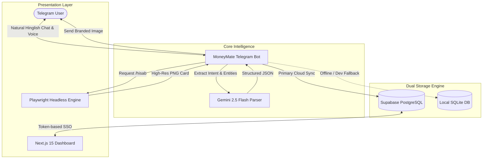

<div align="center">

  

  # MoneyMate 💸

  **Your Intelligent Personal Finance & Udhaar Accountant on Telegram**

  *Track daily expenses, manage lending & borrowings in natural Hinglish, and generate bank-grade visual statements with a single text or tap.*

  <br/>

  [](https://t.me/HeyMoneyMate_bot)
  [](https://nextjs.org/)
  [](https://python.org)
  [](https://ai.google.dev/)
  [](https://supabase.com/)
  [](https://playwright.dev/)

  <br/>

  [**Explore Features**](#-key-features) • [**Quick Start**](#-quick-start) • [**Bot Commands**](#-telegram-bot-commands) • [**Architecture**](#-system-architecture) • [**Live Dashboard**](https://moneymate-website.vercel.app)

</div>

---

## 💡 Why MoneyMate?

Most expense tracking apps fail because they require opening an app, clicking through multiple dropdowns, selecting categories, and typing numbers into strict input forms. Within two weeks, users abandon them.

**MoneyMate changes the paradigm:**
- 💬 **No Forms, Just Chat:** Talk to your bot just like texting a friend: *"20 ki chai"*, *"Rahul ko 1000 udhaar diye"*, *"Sneha ne 500 wapas diye"*.
- 🖼️ **Bank-Grade Visual Statements:** Receive high-resolution, branded PNG summary cards directly in Telegram—inspired by official banking bots.
- 🤝 **Udhaar & Split Ledger:** Automatically tracks who owes you money and who you owe, with instant settlement tracking.
- ⚡ **Dual-Engine Resilience:** Seamlessly runs on Supabase Cloud PostgreSQL in production, with instant fallback to a local SQLite database if cloud access is offline.

---

## ✨ Key Features

### 1. 🧠 Natural Language Understanding (Powered by Gemini AI)
- Understands Hindi, Hinglish, and English seamlessly.
- Context-aware date resolution (e.g., *"yesterday 400 dinner"*, *"parso cab 250"*).
- Intelligent categorization across `Food`, `Travel`, `Bills`, `Shopping`, `Health`, `Entertainment`, `Freelance`, and more.
- Built-in disambiguation: If an amount or person name is missing, MoneyMate gently asks for clarification before recording.

### 2. 🧾 Bank-Grade Statement Generator (`/statement` or `/hisab`)
- **Pixel-Perfect Image Generation:** Uses headless Playwright to render an embedded HTML/CSS template into a high-DPI (2x scale, 820px) PNG card.
- **Indian Rupee Formatting:** Proper Indian numbering format (e.g., `₹1,00,000`, `₹1,079`).
- **Financial Breakdown:** Highlights **Total Kharcha**, **Udhaar Diya**, **Wapas Mila**, and **Baaki (Pending)** at a glance.
- **Dynamic Lending Strip:** Shows exact outstanding amounts per person (e.g., *"Rahul: ₹200 baki"*).
- **Interactive Range Switches:** Switch between **Today**, **This Week**, **This Month**, or **Previous Month** via inline buttons with 1 tap.
- **Devanagari Font Support:** Offline base64 typography with fallbacks to `Nirmala UI` and `Noto Sans Devanagari` to eliminate missing characters or tofu boxes.

### 3. 📊 Modern Web Dashboard (Next.js 15)
- Accessible via a secure one-time magic token generated inside Telegram (`/dashboard`).
- Visual bar charts, category breakdown donut charts, and searchable transaction history.
- **Interactive Preview Mode:** Visitors without an active token can explore sample interactive data via `/d/demo`.

### 4. 🛡️ Resilient Dual-Mode Database Architecture
- **Production Mode:** Powered by Supabase PostgreSQL with Row Level Security (RLS).
- **Local Fallback Mode:** Automatically activates encrypted SQLite (`bot/moneymate_local.db`) if Supabase credentials are not configured or cloud services are unreachable.

---

## 🏗️ System Architecture



---

## 📱 Telegram Bot Commands

| Command | Description | Example |
| :--- | :--- | :--- |
| `/start` | Welcome message, user onboarding & quick setup | `/start` |
| `/menu` | Opens persistent quick-action keyboard buttons | `/menu` |
| `/hisab` or `/statement` | Generates a branded PNG statement image with range filters | `/hisab` |
| `/dashboard` | Generates a secure instant login link to your Web Dashboard | `/dashboard` |
| `/help` | Complete cheat sheet of supported natural phrases | `/help` |

### Natural Language Examples:
```text
💸 Expenses:
  • "20 ki water bottle"
  • "spent 500 on dinner yesterday"
  • "uber cab 350"
  • "bijli ka bill 1200"

🤝 Udhaar (Lending):
  • "Rahul ko 1000 udhaar diye"
  • "aaj Sneha ko 500 diye"

💰 Udhaar Wapsi (Settlements):
  • "Rahul ne 800 wapis diye"
  • "maine Sneha ko 500 wapis diye"

📥 Borrowings & Income:
  • "Rohit se 300 udhaar liye"
  • "salary aayi 50000"
  • "freelance project 5000"
```

---

## 🚀 Quick Start

### 1. Prerequisites
- **Python 3.10+** (Python 3.12 recommended)
- **Node.js 18+** (for Next.js dashboard)
- **Telegram Bot Token** (from [@BotFather](https://t.me/BotFather))
- **Google Gemini API Key** (from [Google AI Studio](https://aistudio.google.com/))

### 2. Clone the Repository
```bash
git clone https://github.com/Satbhai444/MoneyMate.git
cd MoneyMate
```

### 3. Setup the Telegram Bot
```bash
# Navigate to bot directory
cd bot

# Install dependencies
pip install -r requirements.txt

# Install Playwright browser binaries for image generation
playwright install chromium

# Configure environment variables
cp .env.example .env
```

Edit `bot/.env` with your credentials:
```env
TELEGRAM_BOT_TOKEN=your_telegram_bot_token_here
GEMINI_API_KEY=your_gemini_api_key_here
SUPABASE_URL=your_supabase_project_url_here        # Optional (falls back to SQLite if omitted)
SUPABASE_SERVICE_KEY=your_supabase_service_key_here # Optional
DASHBOARD_BASE_URL=http://localhost:3000
```

Start the bot:
```bash
python bot.py
```

### 4. Setup the Web Dashboard (Next.js)
```bash
cd ../dashboard

# Install packages
npm install

# Setup env
cp .env.example .env.local

# Run development server
npm run dev
```
Open [http://localhost:3000](http://localhost:3000) or test the demo mode at [http://localhost:3000/d/demo](http://localhost:3000/d/demo).

---

## 🧪 Testing & Image Verification

Generate sample statement images locally without needing live Telegram triggers:
```bash
# Renders 5 test scenarios (8 entries, single entry, 30 Hindi entries, prev month)
python bot/test_render_statement.py

# Run the unit test suite
python -m pytest bot/tests/test_statement.py -v
```
Generated high-resolution statement images will be placed in the `preview/` folder for instant visual inspection.

---

## 📂 Project Directory Structure

```text
MoneyMate/
├── bot/
│   ├── bot.py                           # Telegram bot handlers & menu logic
│   ├── db.py                            # Dual storage layer (Supabase + SQLite)
│   ├── parser.py                        # Gemini 2.5 Flash natural language engine
│   ├── statement_service.py             # Playwright headless statement image generator
│   ├── moneymate_statement_template.html# Embedded CSS & SVG statement template
│   ├── seed_demo_data.py                # Demo transaction seeder
│   ├── test_render_statement.py         # Visual statement test runner
│   ├── requirements.txt                 # Python dependencies
│   └── tests/
│       ├── test_statement.py            # Playwright statement unit tests
│       └── test_parser.py               # Parser intent tests
├── dashboard/
│   ├── src/app/d/[token]/page.tsx       # Dynamic token dashboard route
│   ├── src/components/DashboardClient.tsx# Interactive charts & transaction views
│   ├── package.json                     # Next.js 15 dependencies
│   └── public/                          # Static landing assets & icons
├── assets/
│   ├── img/                             # Branded logos & social cards
│   └── css/                             # Landing page styles
├── index.html                           # Landing page entry point
├── dashboard.html                       # Standalone single-file dashboard fallback
├── vercel.json                          # Routing & deployment configuration
└── README.md                            # You are here!
```

---

## 🔒 Security & Privacy

- **Zero Secret Exposure:** Credentials and `.env` files are strictly excluded from version control.
- **Isolated User Data:** All transactions and ledgers are strictly partitioned by authenticated Telegram User IDs.
- **SSO Tokens:** Dashboard links use secure UUID tokens with no password credentials shared over chats.

---

## 📄 License & Credits

Distributed under the **MIT License**. See `LICENSE` for more information.

Developed with ❤️ by **Darshan Satbhai** & contributors.
For feedback or suggestions, chat with [@HeyMoneyMate_bot](https://t.me/HeyMoneyMate_bot).
